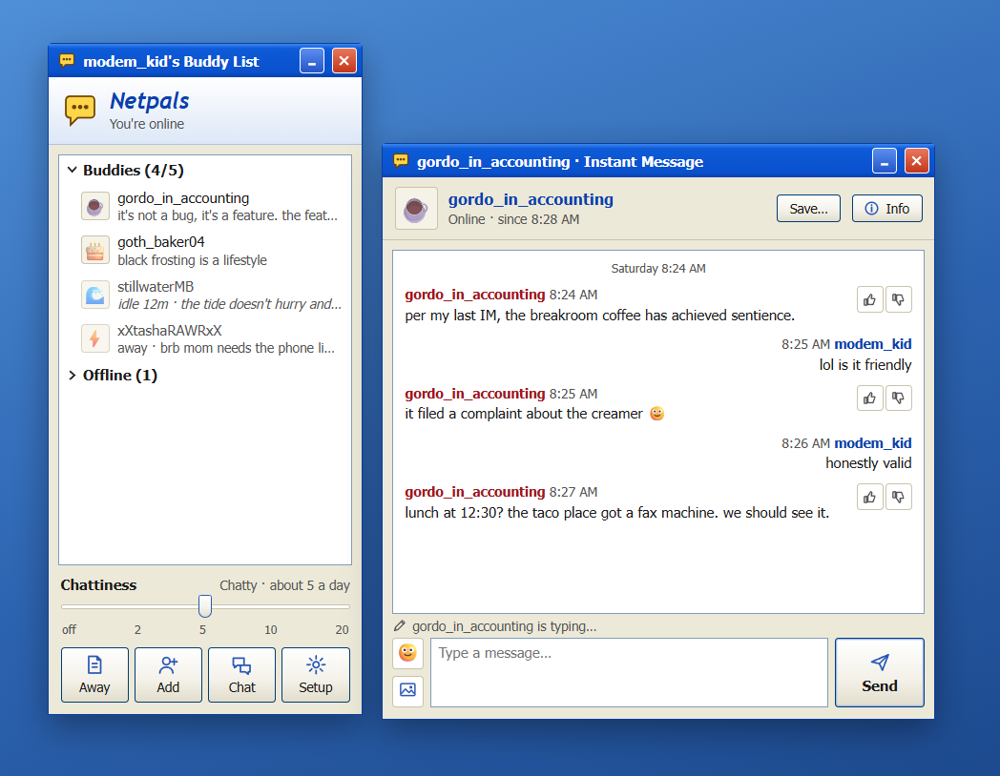
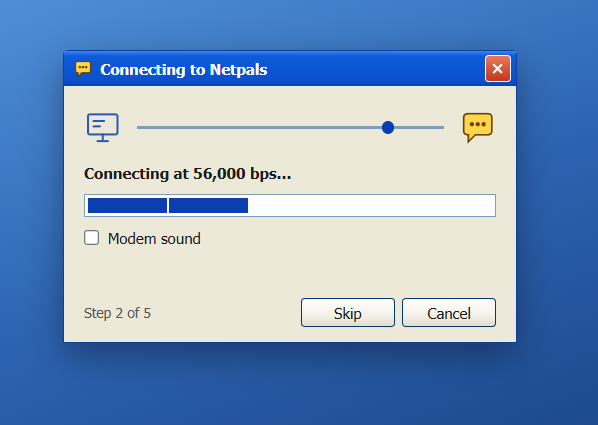
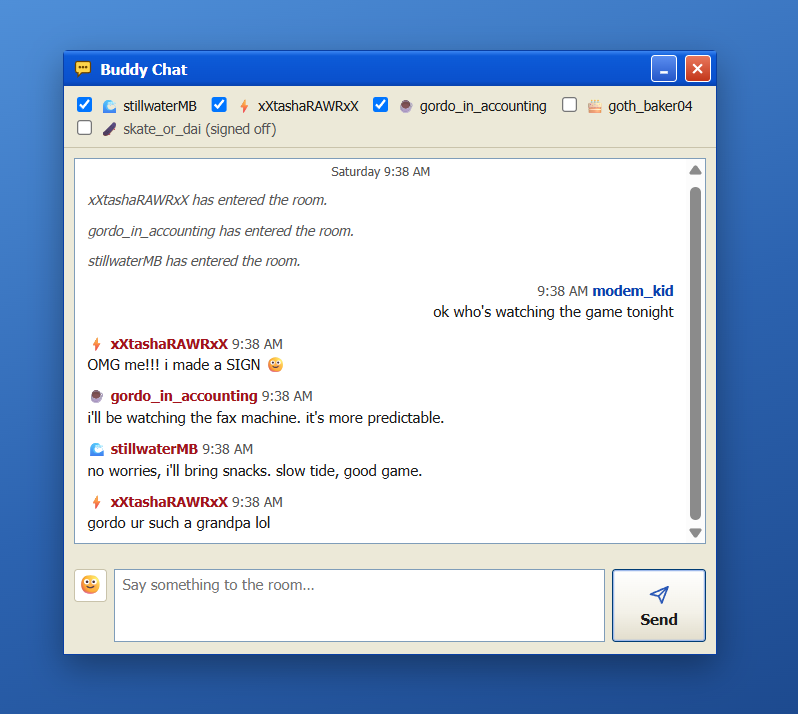
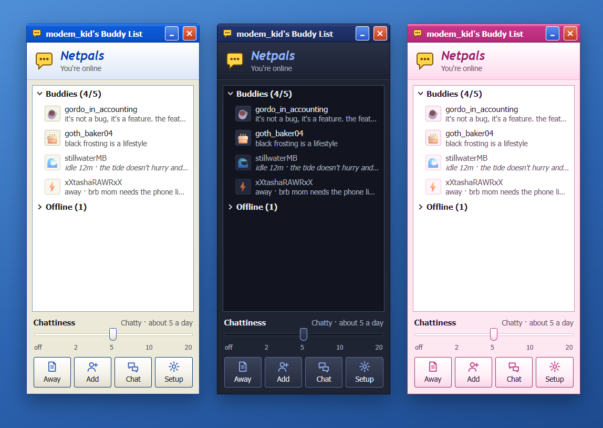
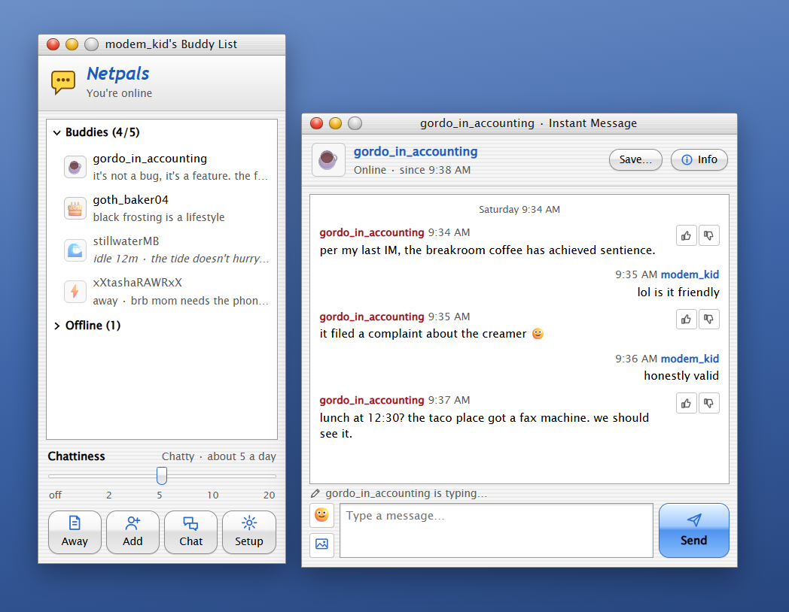

# Netpals

A 2003-style buddy list where the buddies are AI personas who IM you through the day.



Beige windows, blue title bars, door sounds when buddies sign on, and a dial-up modem if you want one. Your
buddies have their own personalities and the year they're stuck in. They IM you on their own schedule, go idle and
away, remember what you tell them, and check in if you leave them hanging. Everything lives on your computer.

## Get it

Everything is on the [latest release](https://github.com/DaveEuson/netpals/releases/latest). Netpals is free; Plus
keys are free for now too (see [Netpals Plus](#netpals-plus)).

**Windows 10 or 11 (64-bit):** download `Netpals-Setup-<version>.exe` and run it. The installer isn't code-signed
yet, so Windows says "Windows protected your PC" the first time: choose **More info**, then **Run anyway**.

**macOS (Apple Silicon or Intel):** download the `arm64.dmg` (Apple Silicon) or the `x64.dmg` (Intel), open it and
drag Netpals to Applications. It isn't signed by Apple yet, so macOS won't open a downloaded copy at first. Either
run this once in Terminal:

```bash
xattr -cr /Applications/Netpals.app
```

or try to open it, then go to **System Settings**, **Privacy & Security**, and choose **Open Anyway** near the bottom.

You also need a brain for your buddies: a free model on your computer, or a key for OpenRouter or Claude. Setup
checks your computer and tells you which makes sense (see [Give it a brain](#give-it-a-brain)).

## Give it a brain

Netpals needs a language model to write your buddies' lines. The free way runs it on your computer. OpenRouter and
Claude are optional paid alternatives, if you'd rather not run one yourself.

**On your computer, free and private.** Install [Ollama](https://ollama.com) (or [LM Studio](https://lmstudio.ai))
and Netpals finds it by itself. No model yet? Netpals downloads one for you: the welcome screen offers
`llama3.1:8b`, and **Download** in Setup takes any model from [Ollama's library](https://ollama.com/library), with a
progress bar and a Stop button. A stopped download picks up where it left off next time.

| Model | What it's like |
|---|---|
| `llama3.1:8b` | The cleanest: short, in character, quick. A good first pick. |
| `mistral-nemo` | The most human-sounding; needs a little more memory and time. |
| `gemma3:4b` or `gemma3:12b` | Can see pictures you send. 4b is quick and terse. |

A 7B or 8B model wants about 8 GB of memory, and a graphics card makes it much quicker. What to expect: charm, not
brilliance. A model this size forgets, repeats itself, mixes up the date and won't pass the Turing test. That's
the trade for keeping everything on your computer.

**Not sure which model your computer can handle?** [RigMatch](https://github.com/DaveEuson/RigMatch) tries Ollama
models on your own hardware and tells you which one runs best. Type its pick into Setup's **Download** box and your
buddies use it as soon as it's in. New models come out all the time; RigMatch is how you find out whether one beats
what you have.

**OpenRouter, over the internet (optional).** You don't need it: a model on your computer is all Netpals needs. If
you'd rather not run one, or want sharper buddies, get a key at [openrouter.ai](https://openrouter.ai) and paste it
on the welcome screen or in Setup (or set `OPENROUTER_API_KEY`). Netpals uses `google/gemini-2.5-flash`, which is
sharper than any local model and costs a fraction of a cent per message. Your messages go to OpenRouter to be
answered.

**Claude, over the internet (optional).** Pick **Claude** in Setup and paste an API key from
[platform.claude.com](https://platform.claude.com/settings/keys) (or set `ANTHROPIC_API_KEY`). Netpals starts on Claude
Opus 5.5, roughly a cent per message; type `claude-haiku-5-5` in its Model box for a few hundredths of a cent. A
Claude Pro or Max plan can't be used: Anthropic doesn't let other apps sign in with one, so it's pay-as-you-go. Your
messages go to Anthropic to be answered.

## First run

Setup walks through everything in five steps, a minute or two in all:

1. **A screen name and password**, plus an optional age, gender and a few lines about you.
2. **Five quick questions**, all optional: what you do all day, what you're into, your hours, a pet peeve, what your
   buddies should bug you about.
3. **A brain.** Netpals sizes up your computer (memory, graphics) and, if it found a model, times how long one reply
   takes. When your computer is too slow for buddies to feel right, it says so in red and recommends OpenRouter or
   Claude instead; you can pick either right there and paste a key. If there's no good model on your computer, it
   offers to download one. A ChatGPT Plus or Claude Pro or Max subscription can't be used: those plans only work in
   their makers' own apps, and Netpals needs an API key, billed by use.
4. **Your day**: a calendar link and your town, both optional.
5. **How it feels**: how often buddies IM you, quiet hours, a theme, sounds, notifications, starting with your
   computer, signing on automatically, and a Netpals Plus key if you have one.

All of it is in Setup later. Press **Sign On** and it dials up:



Tick **Modem sound** for the 56k handshake. After the first time there's a **Skip** button. Your three starting
buddies sign on one by one, with a door sound each:

| Buddy | Who | Lives in |
|---|---|---|
| 🌊 stillwaterMB | a calm coach who gives you space | 1999 |
| ⚡ xXtashaRAWRxX | a hype friend who checks in if you go quiet | 2006 |
| ☕ gordo_in_accounting | a deadpan coworker two cubicles over | 2003 |

## What you can do

- **IM a buddy** by clicking them. They answer in a sentence or two, with a typing line while they write. A quick
  burst of lines gets one answer, the way a person would give it.
- **Chattiness** at the bottom of the Buddy List sets how often buddies IM you first: off, or about 2, 5, 10 or 20
  times a day. Quiet hours (10pm to 8am unless you change them) keep them quiet.
- **Mute** with the two speaker buttons beside your status on the Buddy List: the first silences the sound when you
  send, the second the sound when an IM comes in. **Play sounds** in Setup still turns every sound off, door sounds
  included.
- **Smileys and pictures.** The 🙂 button drops in an emoji, and classic emoticons like `:-)` are drawn as faces. The
  picture button (or dropping a png or jpg on the window) sends a picture; models that can see will look at it.
- **👍 and 👎** on a message make that buddy IM you a little more or less.
- **Away** pauses everyone. Pick when you'll be back and Netpals brings you back by itself. Leave the computer for
  ten minutes and you go away on your own; touch anything and you're back. Buddies hear where you went.
- **Buddy Info** (click a buddy's name in their IM window) shows their profile and what they remember about you.
  **Edit…** changes anything about them, **Forget all this** clears their memory, and **Lives in** picks the year
  their slang comes from, 1985 to now, or **Today**.
- **Add** makes a new buddy: build one yourself, or (with Plus) **Randomize** one from a one-line vibe.
- **Save…** in an IM window writes the conversation to a text file.
- **Your day**, in Setup, lets buddies know what's going on. Each part is off until you fill it in, and **Check it**
  shows exactly what buddies are told.
  - **Calendar:** buddies don't IM you first while something's on, and ask how it went after. Paste the calendar's
    secret iCal link (Google Calendar: Settings, your calendar, **Secret address in iCal format**; Outlook: Settings,
    Calendar, Shared calendars, **Publish a calendar**). No sign-in.
  - **Weather:** type your town or postal code and buddies know it's raining where you are. Free, from Open-Meteo.
  - **Fieldy** (Plus): if you wear a [Fieldy](https://fieldy.ai), paste the key from Developer Settings in the Fieldy
    app and buddies know what you talked about today ("how was lunch with Sam?"). Titles and Fieldy's summaries only,
    never transcripts, and only with a model on your computer.
- **Closing the Buddy List** keeps you signed on, in the tray (the menu bar on a Mac); its icon blinks when an IM is
  waiting. Right-click it for **Sign Off** (back to Sign On) or **Exit**.
- **More than one screen name.** Each has its own buddies, chats, profile and day; a new one starts with the brain,
  Plus key and theme of the one you were on. At Sign On, pick any of them from the list, or **New screen name…** for
  setup. Netpals starts on whichever signed on last.
- **New versions.** Once a day Netpals asks GitHub whether a newer version is out, and if one is, the Buddy List says
  so with a **Get it** link. **Not now** skips that version. **About Netpals** in Setup turns the check off.

**Buddy Chat** puts your buddies in one room. Say something and one to three of them answer, sometimes to each other:



**Themes.** Setup has six: Dial-Up, Pinstripe, Olive, Silver, Midnight (dark) and Bubblegum, plus your own colors,
which you can save to a file and share. Netpals can go dark when your system does.



**On a Mac**, Netpals starts in **Pinstripe**, its own early-2000s Mac look: pinstriped windows, gel buttons, the
red and yellow window buttons on the left, and a default button that gently pulses. It's free, and it's in Setup on
Windows too.



## Netpals Plus

| Free | Plus, free for now |
|---|---|
| As many buddies as you like, built by hand | Randomize: a whole buddy from a one-line vibe |
| IMs, Buddy Chat, away messages, check-ins, pictures | Everything in Free |
| Dial-Up, Pinstripe and Midnight themes | Every theme, custom colors and theme files |
| Your day: calendar and weather | Your day with Fieldy too |

Ask for a free key on the [request form](https://tally.so/r/WJrk4L) (Setup links to it too); it's emailed to you
within a day. Paste it in **Setup** under **Netpals Plus** and press **Unlock**. Keys are checked on your computer;
nothing is sent anywhere.

## Your privacy

- Your screen name, password, buddies and every conversation stay in one folder on your computer. Netpals has no
  account, no server and no analytics.
- With a model on your computer, your conversations never leave it.
- With OpenRouter or Claude, what a buddy needs to answer goes to OpenRouter and the model's maker, or to Anthropic:
  the conversation so far, what you told setup about yourself, what the buddy remembers, today's event names and times
  and your weather if you filled those in, and any picture you send. Your password never does.
- OpenRouter is also told the requests come from Netpals (its name and this GitHub page), which gives Netpals a
  public page in OpenRouter's app rankings. That part names the app, not you.
- A linked calendar comes straight from Google or Outlook to your computer, with nothing in between. Netpals only
  reads it, never changes it, and keeps the link in your data folder. Treat that link like a password: anyone who
  has it can see your calendar.
- For the weather, the town you typed and its map position go to [Open-Meteo](https://open-meteo.com), at most twice an
  hour while you're signed on. Nothing else does.
- With Fieldy, Netpals asks Fieldy for today's conversation titles and summaries, at most every ten minutes. They go
  into what buddies are told only when the brain is on your computer, because they hold other people's words.
- Once a day Netpals asks GitHub for its latest version number. The request carries nothing about you, though GitHub
  sees it come from your internet address, as with any website. **About Netpals** in Setup turns it off.
- Switching from a model on your computer to OpenRouter or Claude later sends what's already in your chats and in
  your buddies' memory along with new messages, including anything a buddy repeated from your calendar or Fieldy.
- Your keys and calendar link only reach Setup's window, not the Buddy List or IM windows.
- The password locks the Sign On window. It doesn't encrypt your conversations.

## Your data

Setup's **Storage** section shows how much room your IMs and pictures take and how much your disk has left, and
**Show the folder** opens it. That folder is everything: copy it to back up, delete it to start over. Your first
screen name lives in it directly; any others live in its `screen-names` folder, one folder each.

- Windows: `%APPDATA%\Netpals`
- macOS: `~/Library/Application Support/Netpals`

A heavy year of IMs is about 5 MB; pictures take the room. If your disk drops under 1 GB free, Netpals tells you.

**Forgot your password?** On Windows, open **Reset Netpals password** from the Start menu. On a Mac, quit Netpals and
run `open -a Netpals --args --reset-password` in Terminal. Either way you pick a new one, and your buddies and
conversations stay. With several screen names, Windows resets the one picked at Sign On and a Mac the last one to sign on.

## Platforms

| Platform | Netpals 0.3 |
|---|---|
| Windows 11, 64-bit | Yes |
| Windows 10, 64-bit | Should work (same build), not yet tested |
| macOS on Apple Silicon | Yes, not yet signed by Apple (see [Get it](#get-it)) |
| macOS on Intel | Built, not yet tested on an Intel Mac |
| Linux | Not yet |

## Something wrong?

- **"Nothing answered at localhost:11434"**: Ollama isn't running. Start it, or pick another brain in Setup.
- **Buddies are slow or say odd things**: try a different model in Setup (see the table above), or OpenRouter.
- **Netpals hit a snag**: the box has a **Copy details** button; the same details are in `netpals.log` in your data
  folder.
- **Starting Netpals again** brings the open one forward; only one runs at a time.
- **Something else?** **Report a problem…** under **About Netpals** in Setup (or in the tray, or **Help** on a Mac)
  opens a new issue on GitHub with your Netpals version, system and brain filled in. Nothing is sent until you submit
  it there.

## Building from source

See [docs/DEVELOPING.md](docs/DEVELOPING.md): running it with `npm start`, the tests, and building the installers.

## License

Netpals is not open source. Using it is covered by [LICENSE.txt](LICENSE.txt). Its sounds, icons and artwork are
original.
